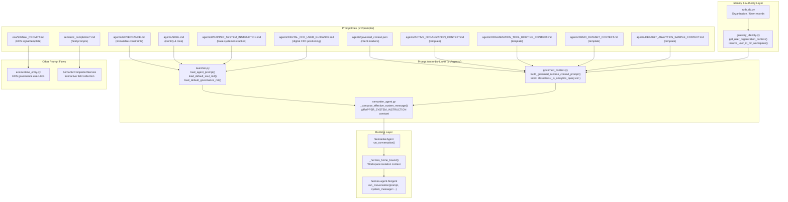
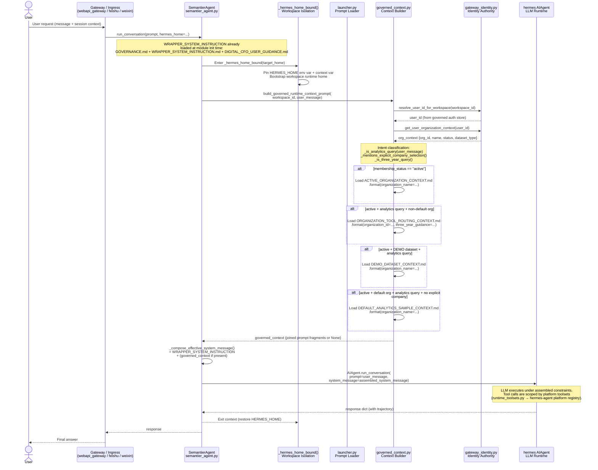

# Prompt Engineering in Semantier Agent System

This document explains how the prompt files under `src/prompts/` are used, composed, and injected into the Semantier agent system for a typical user request.

---

## Prompt Catalog

| Location | File | Role |
|---|---|---|
| `agents/` | `GOVERNANCE.md` | Immutable governance constraints — prepended to every conversation |
| `agents/` | `SOUL.md` | Agent identity, communication style, and tone directives |
| `agents/` | `WRAPPER_SYSTEM_INSTRUCTION.md` | Base system instruction; wraps SOUL directives for runtime injection |
| `agents/` | `DIGITAL_CFO_USER_GUIDANCE.md` | Base digital-CFO positioning and example business questions the agent should prioritize |
| `agents/` | `ACTIVE_ORGANIZATION_CONTEXT.md` | Template — injected when the user has an active org membership |
| `agents/` | `ORGANIZATION_TOOL_ROUTING_CONTEXT.md` | Template — injected for analytics queries on non-default org |
| `agents/` | `DEMO_DATASET_CONTEXT.md` | Template — injected when the active org uses a DEMO dataset |
| `agents/` | `DEFAULT_ANALYTICS_SAMPLE_CONTEXT.md` | Template — injected for analytics queries on the default sample org |
| `agents/` | `governed_context.json` | Intent classification marker lists (analytics, company, 3-year queries) |
| `eos/` | `SIGNAL_PROMPT.md` | Template — drives structured J_t justification from EOS event signals |
| `semantic_completion/` | `amount.md`, `currency.md`, … | Interactive field-collection prompts for the semantic completion flow |

---

## Component Diagram



---

## Prompt Assembly: Layer Structure

For every call to `SemantierAgent.run_conversation()`, the effective system message is assembled in two layers:

### Layer 1 — Static Base (always included)

Built once at module load time in `semantier_agent.py`:

```
WRAPPER_SYSTEM_INSTRUCTION =
    GOVERNANCE.md          ← immutable governance constraints
    +
    WRAPPER_SYSTEM_INSTRUCTION.md   ← operational directives (identity, confidentiality, routing)
    +
    DIGITAL_CFO_USER_GUIDANCE.md    ← user-facing digital CFO positioning and in-scope business questions
```

> `SOUL.md` is available for skills and downstream persona use but is not directly concatenated into the wrapper; it lives as a separate loadable artifact via `load_default_soul_md()`.

### Layer 2 — Governed Context (conditional, per-request)

Built dynamically by `build_governed_runtime_context_prompt()` in `governed_context.py`.  
Each sub-section is gated by **identity resolution** and **intent classification**:

Relative analytics periods are resolved by `agents.temporal_resolution` before
prompt assembly. Prompt text may carry the resolved period IDs for user-facing
guidance, but the date math is not delegated to the LLM.

| Prompt | Condition |
|---|---|
| `ACTIVE_ORGANIZATION_CONTEXT.md` | `membership_status == "active"` |
| `ORGANIZATION_TOOL_ROUTING_CONTEXT.md` | active + analytics query + non-default org |
| `DEMO_DATASET_CONTEXT.md` | active + `dataset_type == "DEMO"` + analytics query |
| `DEFAULT_ANALYTICS_SAMPLE_CONTEXT.md` | active + default org + analytics query + no explicit company marker |

### Final Assembly

```python
# semantier_agent.py — _compose_effective_system_message()
parts = [WRAPPER_SYSTEM_INSTRUCTION]
if governed_context:
    parts.append(governed_context)
system_message = "\n\n".join(parts)
```

---

## Sequence Diagram — Prompt Assembly Lifecycle for a Typical User Request



---

## Other Prompt Flows

### EOS Signal Prompt (`eos/SIGNAL_PROMPT.md`)

Used independently by the EOS governance execution path (`eos/runtime_entry.py`).  
The template receives a `{signal_json}` payload and instructs the model to produce a structured **J_t** (justification triple) with REA semantic claims, ontology version pins, and resource/agent/duality fields.  
This flow is entirely separate from the agent conversation system message.

### Semantic Completion Field Prompts (`semantic_completion/*.md`)

Used by `SemanticCompletionService` for the interactive multi-turn financial event entry flow (Weixin/Feishu channel).  
Each file contains a short prompt string displayed to the user when a required field (`amount`, `currency`, `counterparty`, `invoice_ref`, `description`) is missing.  
These are not injected into the LLM system message; they are user-facing turn prompts surfaced by the API layer.

---

## Governance Invariants

All prompt assembly respects these non-negotiable rules from `AGENTS.md`:

- **Identity is never inferred** — user_id and org_context are resolved only from governed authority sources (`gateway_identity.py` → `auth_db.py`), never from LLM inference or user self-claim.
- **Governance is always first** — `GOVERNANCE.md` is prepended before any other content and cannot be overridden by later prompt fragments.
- **Source code is never disclosed** — `WRAPPER_SYSTEM_INSTRUCTION.md` and `GOVERNANCE.md` both enforce the confidentiality constraint on internal implementation files.
- **Context wins over model memory** — when `governed_context` conflicts with prior assistant messages, the governed context takes precedence (enforced via explicit prompt instruction in `ACTIVE_ORGANIZATION_CONTEXT.md`).
